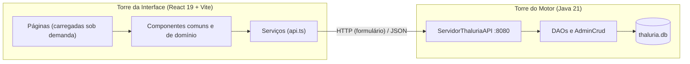

# ⚔️ O Códice de Thalúria

> *Saibam quantos este códice virem que aqui se guardam, por mão de escriba e em letra de forma, as artes e os segredos da Interface de Thalúria: de como se ergue, de como se percorre e de como o Mestre da Mesa governa o mundo que nela habita.*

Esta é a **porta de entrada (front-end)** do Thalúria RPG, lavrada em **React 19, TypeScript, Vite e Tailwind CSS 4**. Ela conversa com o **motor em Java 21** e com o **tomo de memória SQLite (`thaluria.db`)**, que moram no repositório irmão `thaluriaback`.

---

## 📜 Do Ligeiro Começo (para os que têm pressa)

```powershell
# 1. Na torre do servidor (thaluriaback): compila e acende o motor na porta 8080
cd c:\Users\Usuário\Desktop\codigos\thaluriaback
.\iniciar_servidor.bat

# 2. Na torre da interface (thaluriafront): instala e abre os portões em http://localhost:5173
cd c:\Users\Usuário\Desktop\codigos\thaluriafront
npm install
npm run dev
```

| Título | Usuário | Senha |
| :--- | :--- | :--- |
| Mestre da Mesa | `mestre` | `thaluriaadmin` |
| Aventureiro | `jogador1` | `123456` |

---

## 📚 Índice dos Livros

O Códice se divide em sete livros e um apêndice. Cada livro guarda capítulos, e cada capítulo, seus parágrafos numerados.

| Livro | Matéria | Para quem |
| :--- | :--- | :--- |
| [**Livro I — Da Fundação e da Arquitetura**](docs/codice/livro-1-fundacao-e-arquitetura.md) | As duas torres, os materiais da obra, a planta das pastas e o caminho das mensagens | Artífices (programadores) |
| [**Livro II — Dos Rituais de Invocação**](docs/codice/livro-2-rituais-de-invocacao.md) | Instalar, acender o servidor, abrir a interface e os encantamentos do `npm` | Todos |
| [**Livro III — Do Caminho do Aventureiro**](docs/codice/livro-3-caminho-do-aventureiro.md) | Login, forja de personagem, a ficha e suas dez abas, mapa, bestiário e inventário | Jogadores |
| [**Livro IV — Dos Poderes do Mestre**](docs/codice/livro-4-poderes-do-mestre.md) | Painel, sessões ao vivo, névoa de guerra, contas, criação de monstros com imagens e **concessão de itens** | Mestre |
| [**Livro V — Das Artes Visuais e da Boa Ordem**](docs/codice/livro-5-artes-visuais.md) | Paleta em tokens, componentes comuns, responsividade e convenções de código | Artífices |
| [**Livro VI — Dos Pactos com o Servidor**](docs/codice/livro-6-pactos-com-o-servidor.md) | Todas as rotas da API, seus parâmetros e respostas | Artífices |
| [**Livro VII — Da Travessia para a Vercel**](docs/codice/livro-7-travessia-para-a-vercel.md) | Publicar a interface, o túnel da Cloudflare e os perigos a vigiar antes de abrir os portões | Mestre e artífices |
| [**Apêndice — Glossário e Remédios**](docs/codice/apendice-glossario-e-remedios.md) | Termos do reino e soluções para males comuns | Todos |

---

## 🏰 Da Obra em Uma Só Vista



---

## 🛠️ Dos Encantamentos Disponíveis

| Comando | Efeito |
| :--- | :--- |
| `npm run dev` | Abre a interface em modo de ofício, na porta `5173`, com proxy `/api → localhost:8080` |
| `npm run build` | Confere os tipos (`tsc -b`) e forja o pacote de produção em `dist/` |
| `npm run preview` | Mostra localmente o pacote já forjado |
| `npm run lint` | Passa o crivo do `oxlint` sobre o código |

*Assim se encerra o pórtico. Que a vossa leitura prossiga pelos livros.*
