# ⚔️ Thalúria RPG — Front-end & Grimório de Exploração

Interface web imersiva em **React 19, TypeScript, Vite e Tailwind CSS** para o ecossistema do **Thalúria RPG**. O front-end conecta-se diretamente ao motor de regras e persistência em **Java puro (JDK 21)** e banco **SQLite (`thaluria.db`)**, mantendo fidelidade absoluta às regras canônicas de economia, combate e criação de personagens.

---

## 🧭 Índice Rápido

1. [Visão Geral & Arquitetura](#-visão-geral--arquitetura)
2. [Estrutura de Diretórios](#-estrutura-de-diretórios)
3. [Design System Dark Fantasy](#-design-system-dark-fantasy)
4. [Tutorial de Uso Passo a Passo](#-tutorial-de-uso-passo-a-passo)
   * [1. Iniciar o Back-end Java (JDK 21)](#passo-1--iniciar-o-servidor-java-8080)
   * [2. Iniciar o Front-end React (Vite)](#passo-2--iniciar-o-front-end-react)
   * [3. Como Navegar como Jogador](#passo-3--acesso-como-jogador)
   * [4. Como Operar como Mestre](#passo-4--acesso-como-mestre)
5. [Hospedagem na Vercel & Cloudflare Tunnel](#-hospedagem-na-vercel--cloudflare-tunnel)
6. [Integração de Endpoints da API Java](#-integração-de-endpoints-da-api-java)

---

## 🏛️ Visão Geral & Arquitetura

O sistema opera sob o modelo de **arquitetura híbrida desacoplada**:

```mermaid
graph LR
    subgraph Frontend ["Front-end (React 19 + Vite)"]
        UI["Interface Temática (Grimório)"]
        Router["React Router (Rotas Jogador vs Mestre)"]
        AuthCtx["AuthContext (LocalStorage)"]
        ApiClient["api.ts (Proxy / VITE_API_URL)"]
    end

    subgraph Backend ["Back-end Java (JDK 21)"]
        HttpServer["ServidorThaluriaAPI (:8080)"]
        VThreads["Virtual Threads Executor"]
        DAOs["UsuarioDAO / FichaDAO / MonstroDAO"]
        SQLite[("thaluria.db (Modo WAL)")]
    end

    UI --> Router
    Router --> AuthCtx
    AuthCtx --> ApiClient
    ApiClient -->|HTTP/JSON| HttpServer
    HttpServer --> VThreads
    VThreads --> DAOs
    DAOs --> SQLite
```



* **Front-end:** Renderização de interfaces dinâmicas, animações de revelação de raças, zoom interativo no mapa SVG, leitor de grimório e gerenciamento de estados.
* **Back-end Java:** Regras de sorteio de raças (Pity System), cálculo de combate, precificação dinâmica de mercado (Regra do Camarão), Fog-of-War e auditoria contábil.
* **Persistência SQLite:** Banco relacional `thaluria.db` com 17 tabelas em modo Write-Ahead Logging (WAL).

---

## 📁 Estrutura de Diretórios

```plaintext
thaluriafront/
├── public/
│   ├── assets/
│   │   └── mapa-thaluria.png      # Imagem em alta resolução dos 5 Reinos (3.46 MB)
│   └── favicon.svg
├── src/
│   ├── components/
│   │   ├── common/                # Componentes reutilizáveis do Design System
│   │   │   ├── Badge.tsx          # Selos de raridade, elementos e status
│   │   │   ├── Button.tsx         # Botões táteis com brilho dourado e feedback
│   │   │   ├── Card.tsx           # Cartões de grimório com cantos ornamentais
│   │   │   └── Input.tsx          # Campos de formulário com foco dourado e ícones
│   │   └── layout/
│   │       └── Navbar.tsx         # Barra de navegação contextual (Jogador vs Mestre)
│   │
│   ├── contexts/
│   │   └── AuthContext.tsx        # Sessão ativa, papel (JOGADOR/MESTRE) e Pity
│   │
│   ├── layouts/
│   │   ├── AuthLayout.tsx         # Layout para tela de login
│   │   ├── MasterLayout.tsx       # Layout restrito com faixa de autoridade do Mestre
│   │   └── PlayerLayout.tsx       # Layout imersivo para exploração do Jogador
│   │
│   ├── pages/
│   │   ├── auth/
│   │   │   └── LoginPage.tsx      # Acesso temático com atalhos para contas padrão
│   │   ├── master/
│   │   │   ├── ControleMundoPage.tsx     # Fog-of-War (cidades, bestiário, wiki)
│   │   │   ├── GerenciarJogadoresPage.tsx# Cadastro de usuários e limite de fichas
│   │   │   ├── PainelMestrePage.tsx      # Central de comando e avanço de dia
│   │   │   └── SessoesAoVivoPage.tsx     # Monitoramento em tempo real com dicas/reroll
│   │   └── player/
│   │       ├── BestiarioPage.tsx         # Caderno do Explorador (Moveset Pokémon)
│   │       ├── CriarPersonagemPage.tsx   # Forja com sorteio das 3 raças e Pity
│   │       ├── FichaDetalhesPage.tsx     # Atributos, recursos e monstros domados
│   │       ├── InventarioPage.tsx        # Slots de mochila e 10 moedas em Latão
│   │       ├── MapaPage.tsx              # Mapa interativo com zoom e regiões
│   │       ├── PersonagensPage.tsx       # Grimório de fichas do jogador
│   │       ├── VTT3DPage.tsx             # Mesa virtual 3D (Experimental)
│   │       └── WikiPage.tsx              # Documentação com bloqueio progressivo
│   │
│   ├── services/
│   │   ├── api.ts                 # Cliente HTTP unificado com timeout e proxy
│   │   ├── authService.ts         # Login e persistência de sessão
│   │   ├── criacaoService.ts      # Etapas de sorteio e finalização da ficha
│   │   ├── fichasService.ts       # Listagem e consulta de personagens
│   │   └── mundoService.ts        # Fog-of-War, avanço de tempo e intervenções
│   │
│   ├── types/                     # Interfaces TypeScript tipadas
│   │   ├── ficha.ts
│   │   ├── mapa.ts
│   │   ├── monstro.ts
│   │   ├── raca.ts
│   │   └── usuario.ts
│   │
│   ├── utils/
│   │   └── formatadores.ts        # Conversão de Latão para moedas, atributos e cores
│   │
│   ├── App.tsx                    # Roteador central SPA com proteção de acesso
│   ├── index.css                  # Variáveis do Design System e temas de grimório
│   └── main.tsx                   # Ponto de entrada React
├── .env.example                   # Modelo de variáveis de ambiente
├── vercel.json                    # Reescritas SPA para hospedagem na Vercel
├── vite.config.ts                 # Configuração do Vite, Tailwind e proxy /api
└── package.json
```

---

## 🎨 Design System Dark Fantasy

O visual do projeto foi inspirado em **antigos grimórios de couro, pergaminhos com runas e registros de exploradores medievais**:

* **Paleta de Cores:**
  * Fundo Cósmico/Sombrio: `#090a0f` com gradientes sutis de luz arcana.
  * Ouro Real de Thalúria: `#d4af37` (primário), `#ffd700` (brilho) e `#9e782f` (envelhecido).
  * Painéis de Grimório: gradiente `#151822` a `#0e1017` com borda iluminada e cantos em latão.
  * Pergaminho Sépia: `#1b1713` para capítulos selados ou documentos históricos.
* **Tipografia:**
  * Títulos e Cartografia: **Cinzel** e **Cinzel Decorative** (Google Fonts).
  * Leitura e Dados Numéricos: **Plus Jakarta Sans** (legibilidade e suporte numérico).
* **Classes Utilitárias Úteis:**
  * `.grimorio-card`: moldura com cantos ornamentais e efeito de relevo.
  * `.gold-gradient-text`: gradiente metálico para títulos de destaque.
  * `.btn-gold` / `.btn-dark`: botões temáticos com profundidade tátil.

---

## 🚀 Tutorial de Uso Passo a Passo

### Pré-requisitos
* **Java 21 (JDK 21)** instalado (ex.: `C:\JavaJDK\bin\java.exe` ou Temurin 21 no PATH).
* **Node.js 20+** e **npm** instalados.

---

### Passo 1 — Iniciar o Servidor Java (:8080)

Abra um terminal do PowerShell na pasta do back-end (`thaluriaback`):

```powershell
cd c:\Users\Usuário\Desktop\codigos\thaluriaback

# Se o Java 21 for o comando padrão:
java -cp "bin;lib/sqlite-jdbc.jar;lib/slf4j-api.jar;lib/slf4j-simple.jar" servidor.ServidorThaluriaAPI 8080

# Ou apontando diretamente para o JDK 21:
& "C:\JavaJDK\bin\java.exe" -cp "bin;lib/sqlite-jdbc.jar;lib/slf4j-api.jar;lib/slf4j-simple.jar" servidor.ServidorThaluriaAPI 8080
```

> **Mensagem de sucesso esperada:**
> ```text
> Servidor Thaluria API iniciado na porta 8080
> ```

---

### Passo 2 — Iniciar o Front-end React

Abra outro terminal na pasta `thaluriafront`:

```powershell
cd c:\Users\Usuário\Desktop\codigos\thaluriafront

# Instalar dependências (caso seja a primeira execução):
npm install

# Iniciar servidor de desenvolvimento:
npm run dev
```

> O Vite iniciará em **`http://localhost:5173/`**. Abra este endereço no navegador.

---

### Passo 3 — Acesso como Jogador

1. Na tela de login, clique no botão de atalho rápido **"Jogador 1"** (ou digite usuário `jogador1` e senha `123456`).
2. Clique em **"Abrir os Portões"**.
3. **Grimório de Personagens (`/`):**
   * Você verá as fichas do jogador (ex.: *Aventureiro de Ironhold*), seus pontos de Vida, Sanidade, Energia, Mana, Defesa e os 6 Atributos primários.
   * O topo exibe o limite de fichas (`1 / 2 Fichas`) e o Pity acumulado.
4. **Wiki & Regras (`/wiki`):**
   * Navegue pelos capítulos de documentação (*Status*, *Economia*, *Grafiturgia*, *Raças*, *Doma*).
   * Note que capítulos ainda não liberados pelo Mestre exibem o status **"Selado"** com cadeado e mensagem explicativa de Fog-of-War.
5. **Mapa do Continente (`/mapa`):**
   * Visualize o mapa em alta fidelidade com os 5 Reinos (*Frosthelm*, *Sylvanor*, *Aurelia*, *Drakos*, *Valthera*).
6. **Bestiário (`/bestiario`):**
   * Veja criaturas desconhecidas marcadas como `???` e feras estudadas com os 4 golpes do Moveset Pokémon.
7. **Inventário (`/inventario`):**
   * Veja os 50 slots de mochila, capacidade de carga em kg e a conversão de moedas com base em Latão.

---

### Passo 4 — Acesso como Mestre

1. Clique no ícone de saída (topo direito) para encerrar a sessão.
2. Na tela de login, clique no atalho **"Mestre"** (usuário `mestre` e senha `thaluriaadmin`).
3. Clique em **"Abrir os Portões"**.
4. Você será direcionado para o **Painel do Mestre (`/mestre`)** com a faixa indicativa vermelha/dourada:
   * **Avançar Dia de Mercado:** clique no botão para avançar 1 dia no tempo do mundo.
   * **Sessões Ao Vivo (`/mestre/sessoes`):** assiste em tempo real os jogadores criando personagens, permitindo enviar dicas táticas via texto, conceder reroll de atributos, liberar o Impulso Dracônico ou aprovar fichas.
   * **Fog-of-War & Mundo (`/mestre/mundo`):**
     * Desbloqueie capítulos da Wiki para os jogadores com 1 clique (ex.: libere *Economia e Comercio* e volte na tela do jogador para ver o texto revelado).
     * Revele feras do Bestiário (ex.: *Lobo Glacial de Frostdale*).
   * **Jogadores & Contas (`/mestre/jogadores`):**
     * Cadastre novos usuários da mesa com senhas personalizadas.
     * Altere o limite máximo de fichas que cada jogador pode criar.

---

## 🌐 Hospedagem na Vercel & Cloudflare Tunnel

Como o front-end será hospedado na Vercel e o back-end roda no computador local do Mestre:

1. **Baixar o Cloudflare Tunnel (`cloudflared`):**
   * Baixe o executável oficial gratuito no [site da Cloudflare](https://developers.cloudflare.com/cloudflare-one/connections/connect-networks/downloads/).
2. **Iniciar o Túnel no Computador do Mestre:**
   ```powershell
   cloudflared tunnel --url http://localhost:8080
   ```
   * O terminal gerará uma URL segura HTTPS, por exemplo:
     `https://minha-api-thaluria.trycloudflare.com`
3. **Configurar na Vercel:**
   * No painel do seu projeto na Vercel, acesse **Settings $\to$ Environment Variables**.
   * Adicione a variável:
     * **Nome:** `VITE_API_URL`
     * **Valor:** `https://minha-api-thaluria.trycloudflare.com`
   * Faça o deploy. O front-end na Vercel fará chamadas HTTPS seguras para o seu back-end local sem qualquer erro de *Mixed Content*.

---

## 🔌 Integração de Endpoints da API Java

| Endpoint | Método | Descrição | Consumido em |
| :--- | :--- | :--- | :--- |
| `/api/login` | `POST` | Valida credenciais e retorna papel e pity | `LoginPage.tsx` |
| `/api/fichas` | `GET` | Lista fichas canônicas e monstros domados | `PersonagensPage.tsx` |
| `/api/criacao/iniciar` | `POST` | Sorteia Humano + 2 raças com Pity System | `CriarPersonagemPage.tsx` |
| `/api/criacao/escolher-raca` | `POST` | Escolhe raça e rola atributos `[min, max]` | `CriarPersonagemPage.tsx` |
| `/api/criacao/finalizar` | `POST` | Persiste ficha definitiva no SQLite | `CriarPersonagemPage.tsx` |
| `/api/conteudo/visivel` | `GET` | Retorna Wiki, Mapa e Bestiário com Fog-of-War | `WikiPage.tsx`, `BestiarioPage.tsx` |
| `/api/mestre/sessoes-ao-vivo` | `GET` | Polling das sessões de criação em andamento | `SessoesAoVivoPage.tsx` |
| `/api/mestre/assistir-sessao` | `POST` | Dica, reroll, impulso dracônico ou aprovação | `SessoesAoVivoPage.tsx` |
| `/api/mestre/controle-mundo` | `POST` | Avança dia, libera wiki e revela bestiário | `ControleMundoPage.tsx` |
| `/api/mestre/usuarios` | `POST` | Cadastra contas ou altera limites de fichas | `GerenciarJogadoresPage.tsx` |

---

## 🛠️ Scripts Disponíveis

* `npm run dev`: inicia o servidor local de desenvolvimento na porta `5173`.
* `npm run build`: valida tipagem TypeScript (`tsc -b`) e gera o bundle de produção otimizado na pasta `dist/`.
* `npm run preview`: visualiza localmente a versão compilada de produção.
