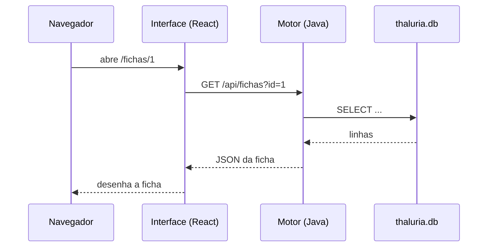

# Livro I — Da Fundação e da Arquitetura

> *Onde se conta de que pedras foi erguida a obra, como se repartem as suas salas e por que caminhos correm os mensageiros entre as torres.*

[← Voltar ao Pórtico](../../README.md) · [Livro II →](livro-2-rituais-de-invocacao.md)

---

## Capítulo I — Do Propósito da Obra

### § 1. Da razão de existir

A Interface de Thalúria foi erguida para que **aventureiros** mantenham suas fichas, explorem o mapa e consultem o bestiário, e para que o **Mestre da Mesa** governe o mundo: revele cidades, entregue itens, crie criaturas e vigie as forjas de personagens em tempo real.

### § 2. Do que a Interface não faz

Nenhuma regra de jogo é decidida na Interface. Sorteio de raças, cálculo de vida e mana, preço das lojas e névoa de guerra são ofício do **Motor em Java**. A Interface apenas mostra, pergunta e envia. Quando houver dúvida entre o que a tela mostra e o que o servidor responde, **vale a palavra do servidor**.

---

## Capítulo II — Das Duas Torres

### § 1. A Torre da Interface (`thaluriafront`)

Aplicação de página única (SPA). Roda no navegador e é servida, em produção, pela **Vercel**.

### § 2. A Torre do Motor (`thaluriaback`)

Servidor HTTP nativo do JDK 21 (`ServidorThaluriaAPI`), com *virtual threads*, escutando na porta **8080**. Guarda tudo em `thaluria.db` (SQLite).

### § 3. Da ponte entre elas



---

## Capítulo III — Dos Materiais da Obra

| Material | Versão | Ofício |
| :--- | :--- | :--- |
| React | 19 | Desenho das telas |
| TypeScript | 6 | Contratos de tipos entre telas e servidor |
| Vite | 8 | Forja e servidor de ofício |
| Tailwind CSS | 4 | Estilos, com a paleta declarada em `@theme` |
| React Router | 7 | Caminhos (rotas) do jogador e do Mestre |
| lucide-react | 1 | Ícones |
| oxlint | 1 | Crivo de qualidade do código |

---

## Capítulo IV — Da Planta do Castelo

### § 1. Do mapa das pastas

```plaintext
src/
├── App.tsx                 Rotas; cada página é carregada sob demanda (lazy)
├── main.tsx                Ponto de entrada
├── index.css               Paleta (@theme), classes de painel, botões e campos
├── components/
│   ├── common/             Peças de uso geral (ver Livro V)
│   ├── admin/              Gerenciador do mundo (formulário por esquema, tabela, modal, sublista)
│   ├── bestiario/          CartaoMonstro: a entrada do bestiário
│   ├── ficha/              Abas e modais da ficha de personagem
│   ├── layout/             Navbar
│   └── map/                O atlas (ver § 3)
├── contexts/AuthContext    Sessão atual (usuário, papel, pity)
├── data/                   Dados fixos: atlas, moedas, raças
├── hooks/                  Ganchos reutilizáveis
├── layouts/                Moldura do jogador e do Mestre (protegem as rotas)
├── pages/                  Uma página por rota (auth/, player/, master/)
├── services/               Conversa com o servidor (api.ts e serviços por assunto)
├── types/                  Contratos TypeScript das respostas do servidor
└── utils/                  Cálculos da ficha, formatadores, imagem
```

### § 2. Da lei das camadas

1. **Páginas** orquestram: buscam dados, guardam estado e compõem componentes.
2. **Componentes** desenham e avisam a página por *callbacks* (`onSalvo`, `onAtualizado`...).
3. **Serviços** são os únicos que chamam `requestApi`. Nenhum componente monta URL à mão.
4. **Tipos** descrevem exatamente o JSON do servidor; quando o servidor muda, muda-se o tipo primeiro.

### § 3. Do atlas e de suas quatro partes

O mapa, outrora um só pergaminho de 1828 linhas, foi repartido:

| Arquivo | Conteúdo |
| :--- | :--- |
| `map/MapaThaluria.tsx` | O componente: zoom, arraste, névoa, seleção de cidades |
| `map/estiloMapa.ts` | Paleta de tinta e papel, fontes, rótulos, tipos compartilhados, vista e zoom |
| `map/ornamentosMapa.tsx` | Símbolos de terreno, glifos das cidades, rosa dos ventos, escala, título e camada base |
| `map/interfaceMapa.tsx` | Botões do mapa, legenda e o painel da cidade selecionada |
| `map/construirAtlas.ts`, `geometria.ts`, `tracadoRotas.ts` | Geometria do continente e traçado das rotas |

### § 4. Do gerenciador do mundo e de suas partes

| Arquivo | Conteúdo |
| :--- | :--- |
| `pages/master/GerenciarMundoPage.tsx` | Abas por entidade, busca e lista |
| `admin/registros.ts` | Títulos, formatação de células, conversão de monstro para pré-visualização |
| `admin/FormularioRegistro.tsx` | Formulário montado a partir do esquema do servidor, com seções e campo de imagem |
| `admin/ModalRegistro.tsx` | Editor de um registro, com mapa (cidades, rotas) e pré-visualização (monstros) |
| `admin/SubLista.tsx` | Registros filhos: golpes, drops, insumos, estoque |
| `admin/TabelaRegistros.tsx` | Tabela no computador, cartões no celular |

---

## Capítulo V — Do Caminho dos Mensageiros

### § 1. Do cliente único (`services/api.ts`)

Toda conversa passa por `requestApi(endpoint, opcoes)`:

- **GET** envia parâmetros na URL.
- **POST** envia o corpo como `application/x-www-form-urlencoded`. Imagens em base64 viajam no corpo, nunca na URL, para não provocar o erro HTTP 431.
- Tempo de espera padrão: **12 segundos**. Ao estourar, a mensagem é *"Tempo de resposta excedido. Verifique se o servidor Java está ligado."*
- Erros do servidor chegam como `{"erro": "..."}` e viram `ApiError` com a mensagem pronta para a tela.

### § 2. Do endereço do servidor

| Onde | Endereço usado |
| :--- | :--- |
| Ofício local (`npm run dev`) | `VITE_API_URL` vazio → o Vite repassa `/api` para `http://localhost:8080` |
| Produção (Vercel) | `VITE_API_URL=https://...` (o túnel da Cloudflare, ver Livro VII) |

### § 3. Da sessão

O `AuthContext` guarda a conta no `localStorage` do navegador. As molduras `PlayerLayout` e `MasterLayout` mandam para `/login` quem não tem sessão, e o `MasterLayout` devolve ao início quem não é Mestre.

> ⚠️ **Advertência do escriba:** esta guarda vive só no navegador. O servidor ainda não confere quem pede. Leia o Livro VII, Capítulo IV, antes de abrir o reino ao mundo.

---

*Aqui finda o Livro I.*
