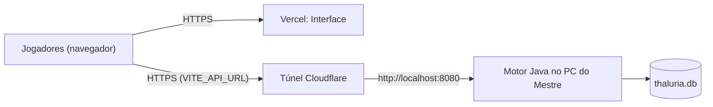

# Livro VII — Da Travessia para a Vercel

> *Onde se ensina a levar a Interface para além das muralhas da casa do Mestre, e se adverte, com toda a franqueza, dos perigos que aguardam quem abre os portões sem guarda.*

[← Livro VI](livro-6-pactos-com-o-servidor.md) · [Pórtico](../../README.md) · [Apêndice →](apendice-glossario-e-remedios.md)

---

## Capítulo I — Do Desenho da Travessia



A **Vercel** serve só os arquivos da Interface. O **Motor continua no computador do Mestre**: se o PC dormir, o jogo para.

---

## Capítulo II — Do Que Já Está Pronto

| Peça | Estado |
| :--- | :--- |
| `npm run build` | ✅ Passa sem erros nem avisos de tamanho |
| `vercel.json` | ✅ Reescreve toda rota para `index.html` (o recarregar de `/fichas/3` funciona) |
| `services/api.ts` | ✅ Lê `VITE_API_URL` |
| CORS do Motor | ✅ `Access-Control-Allow-Origin: *` |
| Páginas sob demanda | ✅ Pacote principal ~280 KB (antes 587 KB) |

---

## Capítulo III — Dos Passos da Travessia

### § 1. Do túnel

```powershell
# Com o Motor já aceso na porta 8080:
cloudflared tunnel --url http://localhost:8080
```

Anote o endereço `https://....trycloudflare.com` que surgir.

> 🕯️ O túnel rápido muda de endereço **a cada vez** que é aceso. Para um endereço fixo, crie um túnel nomeado numa conta Cloudflare com domínio próprio.

### § 2. Do projeto na Vercel

1. Envie o repositório `thaluriafront` ao GitHub.
2. Na Vercel: **Add New → Project** e escolha o repositório.
3. *Framework Preset*: **Vite**. *Build Command*: `npm run build`. *Output Directory*: `dist`.
4. Em **Environment Variables**, crie `VITE_API_URL` com o endereço do túnel, **sem barra no fim**.
5. **Deploy**.

### § 3. Da troca de endereço do túnel

`VITE_API_URL` é gravado no pacote **no momento do build**. Se o endereço mudar, atualize a variável e faça **Redeploy**.

---

## Capítulo IV — Das Guardas do Portão

> ⚔️ *Outrora o Motor aceitava qualquer pedido. Hoje cada porta tem sentinela.*

### § 1. Do selo de entrada
- Ao entrar, o Motor entrega um **token aleatório de 256 bits**, válido por **30 dias**.
- O banco guarda só o **SHA-256** do token (tabela `sessoes_login`). Quem copiar o `thaluria.db` não consegue abrir sessões.
- **Sair** invalida o token no Motor, não apenas no navegador.

### § 2. Das senhas
- Guardadas com **PBKDF2-HMAC-SHA256**, 120.000 iterações e sal próprio.
- Senhas antigas em texto puro são convertidas no primeiro acendimento do Motor.
- **8 senhas erradas em 15 minutos** bloqueiam aquela conta pelo resto da janela (resposta 429).
- Quando o Mestre define uma senha nova para uma conta, todas as sessões abertas dela caem.

### § 3. Das permissões (decididas pelo Motor)

| Quem | Pode |
| :--- | :--- |
| Sem selo | Apenas `/api/login` e `/api/logout` |
| Jogador | Ler e alterar **só as próprias fichas**; forjar personagem **só para si**; ver mapa, wiki e bestiário filtrados pela névoa |
| Mestre | Tudo: `/api/admin/*`, `/api/mestre/*`, conceder e retirar itens, qualquer ficha |

O papel é lido do banco **a cada pedido**. Parâmetros como `papel`, `usuarioId` e `username` enviados pelo navegador são **reescritos** pelo Motor, de modo que o jogador não se faz passar por Mestre nem por outro jogador.

### § 4. Das cautelas que ainda cabem ao Mestre
1. Troque a senha padrão `thaluriaadmin` antes de publicar.
2. Faça cópia do `thaluria.db` antes de cada sessão.
3. Desligue o túnel quando não houver jogo: o PC do Mestre fica menos exposto.
4. O bloqueio de senhas vive na memória; reiniciar o Motor o zera.

### § 5. Do peso das imagens
Retratos e ilustrações moram no banco, em base64 (~30–80 KB cada após a redução). Com centenas de imagens, listas como o bestiário ficam pesadas para o túnel. Se o catálogo crescer muito, vale guardar as imagens como arquivos e servir só o endereço.

---

## Capítulo V — Do Rol de Conferência Antes de Publicar

- [ ] `npm run build` passa.
- [ ] Motor aceso e túnel ativo.
- [ ] `VITE_API_URL` atualizado na Vercel e redeploy feito.
- [ ] Motor reiniciado com `iniciar_servidor.bat` (aplica tokens e hash de senhas).
- [ ] Senha do Mestre trocada.
- [ ] Cópia do `thaluria.db` guardada.
- [ ] Entrar pelo link da Vercel no celular e abrir uma ficha.

---

*Aqui finda o Livro VII.*
