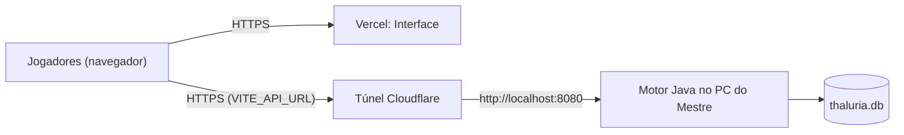

# Livro VII — Da Travessia para a Vercel

> *Onde se ensina a levar a Interface para além das muralhas da casa do Mestre, e se adverte, com toda a franqueza, dos perigos que aguardam quem abre os portões sem guarda.*

[← Livro VI](livro-6-pactos-com-o-servidor.md) · [Pórtico](../../README.md) · [Apêndice →](apendice-glossario-e-remedios.md)

---

## Capítulo I — Do Desenho da Travessia



A **Vercel** serve só os arquivos da Interface. O **Motor continua no computador do Mestre**: se o PC dormir, o jogo para.

---

## Capítulo II — Do Que Já Está Pronto

| Peça | Estado |
| :--- | :--- |
| `npm run build` | ✅ Passa sem erros nem avisos de tamanho |
| `vercel.json` | ✅ Reescreve toda rota para `index.html` (o recarregar de `/fichas/3` funciona) |
| `services/api.ts` | ✅ Lê `VITE_API_URL` |
| CORS do Motor | ✅ `Access-Control-Allow-Origin: *` |
| Páginas sob demanda | ✅ Pacote principal ~280 KB (antes 587 KB) |

---

## Capítulo III — Dos Passos da Travessia

### § 1. Do túnel

```powershell
# Com o Motor já aceso na porta 8080:
cloudflared tunnel --url http://localhost:8080
```

Anote o endereço `https://....trycloudflare.com` que surgir.

> 🕯️ O túnel rápido muda de endereço **a cada vez** que é aceso. Para um endereço fixo, crie um túnel nomeado numa conta Cloudflare com domínio próprio.

### § 2. Do projeto na Vercel

1. Envie o repositório `thaluriafront` ao GitHub.
2. Na Vercel: **Add New → Project** e escolha o repositório.
3. *Framework Preset*: **Vite**. *Build Command*: `npm run build`. *Output Directory*: `dist`.
4. Em **Environment Variables**, crie `VITE_API_URL` com o endereço do túnel, **sem barra no fim**.
5. **Deploy**.

### § 3. Da troca de endereço do túnel

`VITE_API_URL` é gravado no pacote **no momento do build**. Se o endereço mudar, atualize a variável e faça **Redeploy**.

---

## Capítulo IV — Das Advertências Graves

> ⚔️ *Leia este capítulo inteiro antes de passar o link aos jogadores.*

### § 1. Do portão sem guarda

O Motor **não confere quem faz o pedido**. O papel de Mestre fica só no navegador, e as rotas `/api/admin/*`, `/api/mestre/*` e `/api/fichas/*` aceitam qualquer chamada. Quem descobrir o endereço do túnel pode, com uma simples ferramenta de linha de comando:

- apagar monstros, itens, cidades e fichas;
- criar contas de Mestre;
- ler as fichas de todos.

### § 2. Do remédio recomendado

Antes de abrir o reino a estranhos, o Motor precisa de **sessões com token**: o `/api/login` devolve um token, a Interface o envia em cada pedido, e o Motor recusa rotas de Mestre a quem não for Mestre. Até lá:

1. Use o túnel só durante as sessões de jogo e desligue-o depois.
2. Passe o endereço apenas aos jogadores da mesa.
3. Troque a senha padrão do Mestre.
4. Faça cópia do `thaluria.db` antes de cada sessão.

### § 3. Do peso das imagens

Retratos e ilustrações moram no banco, em base64 (~30–80 KB cada após a redução). Com centenas de imagens, listas como o bestiário ficam pesadas para o túnel. Se o catálogo crescer muito, vale guardar as imagens como arquivos e servir só o endereço.

### § 4. Do arquivo esquecido

`public/file_00000000c53c820eb8cd75238da59f45.png` (3,4 MB) não é usado pelo código, mas vai junto em cada publicação. Pode ser apagado se não tiver outro uso.

---

## Capítulo V — Do Rol de Conferência Antes de Publicar

- [ ] `npm run build` passa.
- [ ] Motor aceso e túnel ativo.
- [ ] `VITE_API_URL` atualizado na Vercel e redeploy feito.
- [ ] Senha do Mestre trocada.
- [ ] Cópia do `thaluria.db` guardada.
- [ ] Entrar pelo link da Vercel no celular e abrir uma ficha.

---

*Aqui finda o Livro VII.*
